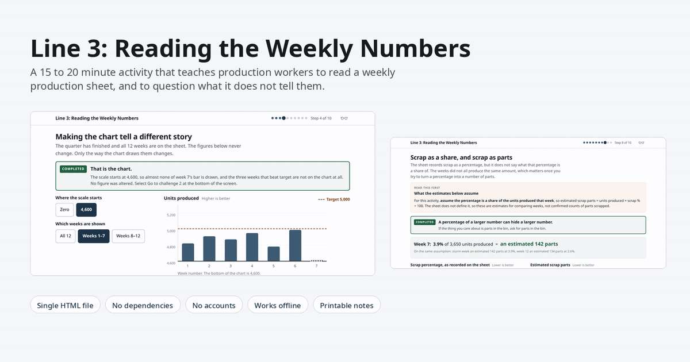
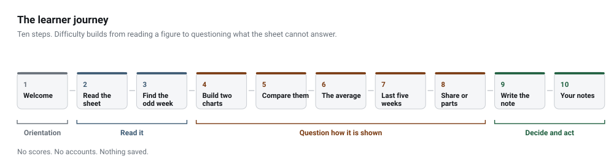
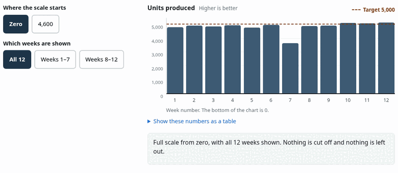
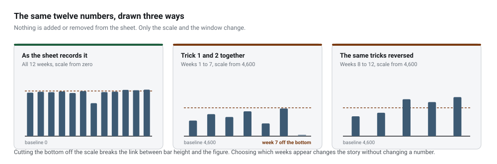
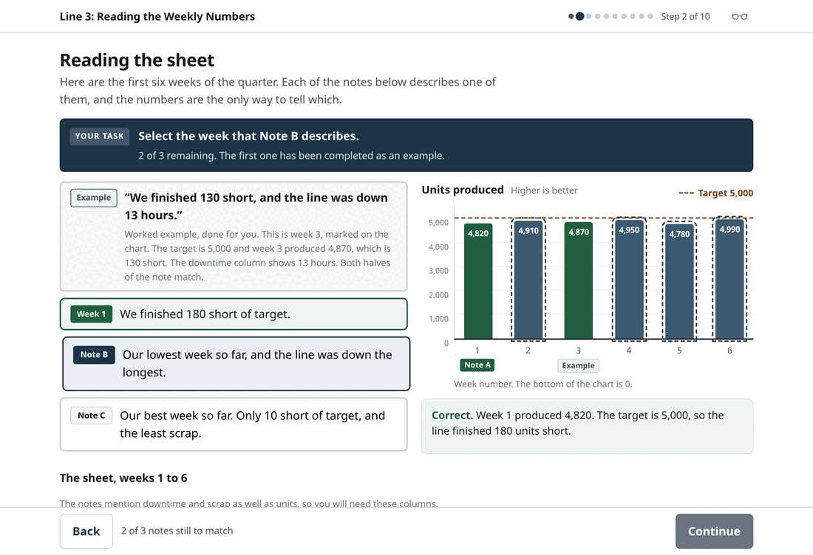
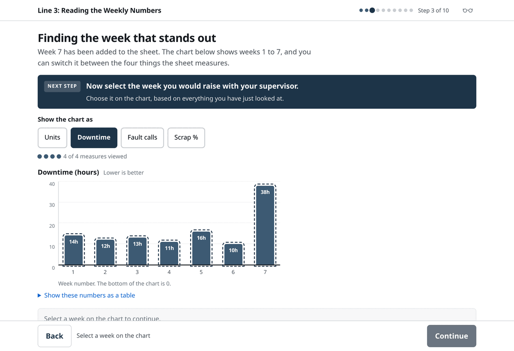
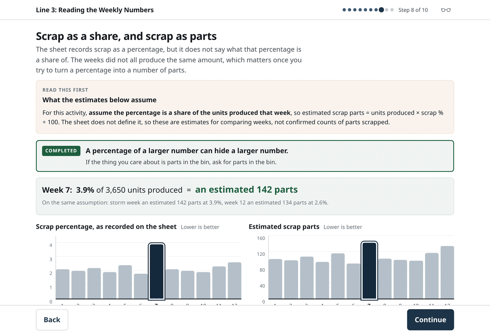
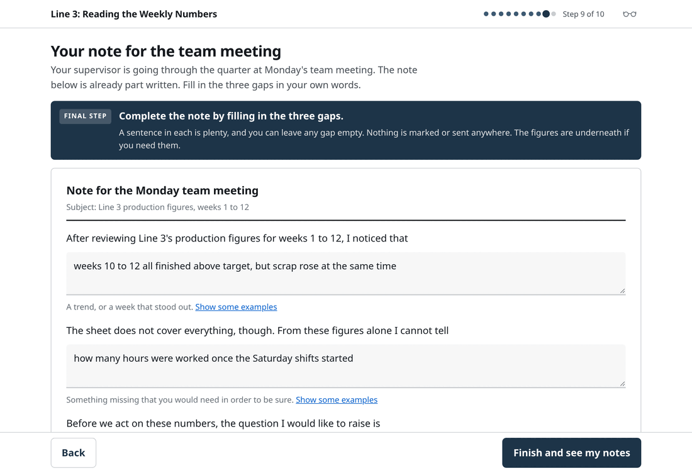
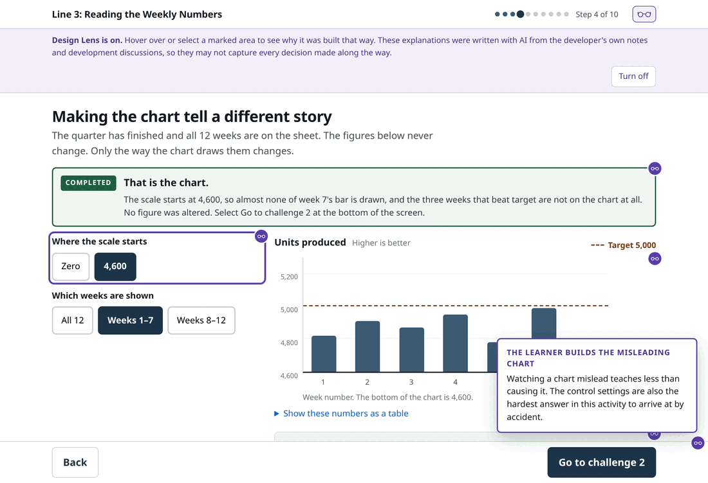

<div align="center">

<picture>
  <source media="(prefers-color-scheme: dark)" srcset="docs/assets/hero-dark.png">
  
</picture>

<p><strong>A standalone, browser-based data literacy activity for people who read production figures at work.</strong></p>

<p><sub>10 to 20 minutes&nbsp; · &nbsp;no installation&nbsp; · &nbsp;no account&nbsp; · &nbsp;single HTML file&nbsp; · &nbsp;no runtime dependencies</sub></p>

<p><sub>Built for the Gordon TAFE Learning Experience Design candidate task, <em>Read the Numbers</em>.</sub></p>

</div>

> [!NOTE]
> **No public deployment yet.** Open `public/index.html` in a browser, or see
> [Getting started](#getting-started). A launch link will be added here once hosting is configured.

---

## The problem

Machine operators, packers and maintenance assistants read production figures every week. Most have
no formal data training, and many do not use computers much at work. They are not short of
judgement, and they are usually the people who know what actually happened on the floor.

The gap is not arithmetic. It is that a sheet of numbers can be entirely accurate and still leave
the wrong impression, and that spotting this takes a particular habit of mind rather than a maths
qualification.

**The scenario.** Ridgeway Components is a fictional manufacturer. Line 3 makes brake housings, and
every Monday the supervisor pins a one-page summary of the line's numbers on the noticeboard. The
activity uses twelve weeks from that sheet, reproduced exactly as the brief supplies them:

| | Weeks 1&ndash;6 | Week 7 | Weeks 8&ndash;9 | Weeks 10&ndash;12 |
|---|---|---|---|---|
| **Units produced** | 4,780 to 4,990 | 3,650 | 4,880, 4,930 | 5,120, 5,080, 5,150 |
| **What the sheet says** | a steady run, all under target | severe storm, site lost power | back to normal | three weeks above target |
| **What it does not say** | &mdash; | how much of the shortfall the outage caused | &mdash; | Saturday overtime began, and fault calls moved to a new form |

Scrap climbs to its second-highest level of the quarter during the three best weeks. That is the
kind of thing this activity is built to make visible.

---

## What the learner walks away with

<picture>
  <source media="(prefers-color-scheme: dark)" srcset="docs/assets/outcomes-dark.svg">
  
</picture>

Five ways figures can mislead are covered in total: a scale that does not start at zero, showing
only part of the period, an average pulled by one unusual week, a percentage that hides a count, and
a measure recorded differently from week 10 onwards.

---

## The experience

Ten short steps. Each one has a single idea and a single thing to do, and difficulty builds from
reading a figure to questioning what the sheet cannot answer.

<picture>
  <source media="(prefers-color-scheme: dark)" srcset="docs/assets/journey-dark.svg">
  
</picture>

### The chart that tells two stories

The strongest moment in the activity. The learner is asked to make Line 3 look like it is in
trouble, then to make the same twelve figures look like a success. They do it themselves, using two
controls: where the scale starts, and which weeks are shown.

<div align="center">

<p></p>

<p><sub><strong>Same twelve numbers, three framings.</strong> Nothing is added or removed from the sheet.</sub></p>

</div>

<details>
<summary>Static version of the sequence above, without animation</summary>

<br>


</details>

Once both charts are built, each change is isolated so the method is clear rather than memorised:

<picture>
  <source media="(prefers-color-scheme: dark)" srcset="docs/assets/tricks-dark.svg">
  
</picture>

### The other steps

<table>
<tr>
<td width="50%" valign="top">

<strong>Reading the sheet</strong><br><br>

Three plain-words notes have to be matched to the weeks they describe. Placing one means comparing
two columns and doing the subtraction. One is worked through first, with the arithmetic shown.



</td>
<td width="50%" valign="top">

<strong>Finding the week that stands out</strong><br><br>

All four measures have to be looked at before a week can be chosen, so the learner reaches a view of
their own before anything is explained to them.



</td>
</tr>
<tr>
<td width="50%" valign="top">

<strong>A share, or a count</strong><br><br>

Week 12 is the strongest week on the sheet for units, and on the activity's stated assumption it
still scrapped an estimated 134 parts against the storm week's 142. Two linked charts make the
difference visible.



</td>
<td width="50%" valign="top">

<strong>A note for the Monday meeting</strong><br><br>

The activity ends with a part-written workplace note with three gaps. The surrounding sentences
carry the structure, so the learner only supplies the thinking. It prints.



</td>
</tr>
</table>

---

## Why it was built this way

Every decision below is recorded in [`Resources/Admin/design-decisions.md`](Resources/Admin/design-decisions.md),
along with the options that were rejected and why.

| Decision | Reasoning |
|---|---|
| **No multiple-choice questions anywhere** | The brief asks for more than a quiz. Each step uses a different interaction: matching, measure switching, chart controls, column reveals, linked charts, sentence completion. |
| **The learner causes the deception** | Watching a chart mislead teaches less than building one. The control settings are also the hardest answer here to arrive at by accident. |
| **Investigation before explanation** | On the week 7 step, all four measures must be viewed before a week can be chosen. The explanation follows the learner's own conclusion rather than replacing it. |
| **A worked example before practice** | Required by the brief. One note is matched first with the arithmetic shown, so the first attempt is not also the first explanation. |
| **Feedback explains, it does not mark** | A wrong match replies with the figures for the week that was actually clicked, so a mistake still teaches the table. |
| **Both answers can be right** | On the week 7 decision, raising it and not raising it both receive the same reasoning. The activity does not tell the learner what to conclude. |
| **Assumptions are stated before use** | The scrap-in-parts figures depend on an assumption the brief never confirms. That assumption appears above the charts, before any estimate, and the figures are labelled estimates throughout. |
| **An authentic end task** | A workplace note the learner can print, not an assessment form. The printout separates what they wrote from what the activity supplied. |
| **Designed for low digital confidence** | One instruction on screen at all times, one primary button, the same click-the-data interaction throughout, and the current task, its control and its response kept together on one screen. |
| **Nothing is scored or saved** | The brief names shared computers. Saved answers would be visible to the next person, and a score would change what the activity is for. |

---

## Design Lens

An optional feature for reviewers, off by default. The glasses icon in the header turns it on;
marked areas of the page then carry a small marker, and hovering the area or selecting the marker
shows a short note on why that part was built the way it was.



It exists so an interview panel can see the reasoning without reading the documentation. Nineteen
areas are annotated across the ten steps.

> [!IMPORTANT]
> The Design Lens explanations were written with AI from the developer's own notes and development
> discussions. They restate decisions that are already recorded in this repository, but they are
> summaries and may not capture every decision made along the way. Where no reason was recorded,
> nothing is marked. The activity states this on screen whenever the feature is on.

Design Lens never prints, does not alter the activity, and does not affect a learner's progress.

---

## Technical overview

Vanilla HTML, CSS and JavaScript in one file. No framework, no build step, no bundler, no backend,
no analytics, no cookies, no network requests at runtime.

| | |
|---|---|
| **Delivery** | One `index.html`, about 100 KB. Runs from `file://` or any static host. |
| **Data** | A single `DATA` array is the only source of truth. Averages, the median and the scrap estimates are computed from it at runtime, so no figure on screen can drift from the brief. |
| **Charts** | Hand-built from HTML and CSS. Bars are real `<button>` elements where clicking does something, and plain `<div>` elements where it does not, so no focusable control is ever inert. |
| **Accessibility** | Keyboard navigable, focus restored to the control used after every redraw, a persistent live region for feedback, a table equivalent for every chart, and colour never the only signal. |
| **Motion** | All animation sits behind `prefers-reduced-motion`. |
| **Privacy** | No accounts, no storage, no tracking. Nothing the learner types leaves the page. |
| **Output** | A printable workplace note, generated from the learner's own input. |

```
GORDON-Line3/
├── public/
│   └── index.html                 the activity — the only file that gets deployed
├── docs/
│   └── assets/                    README screenshots, diagrams and animation
├── Resources/
│   ├── Candidate_Brief_Read_the_Numbers.docx
│   ├── Init-Project-Notes.md      the candidate's own planning notes
│   └── Admin/
│       ├── proposed-approach.md   the approach agreed before any code was written
│       ├── design-decisions.md    decisions, rejected options and future work
│       ├── review-findings.md     all feedback received and how each item was handled
│       ├── testing-results.md     testing performed on every version
│       ├── prompt-history.md      full AI prompt history, including discarded approaches
│       └── *.html / *.md          three independent review reports, unedited
└── README.md
```

---

## Getting started

```bash
git clone git@github.com:thelocalfrogman/GORDON-Line3.git
cd GORDON-Line3
```

Then open the file. No server, no install, no build:

```bash
xdg-open public/index.html     # Linux
open public/index.html         # macOS
start public\index.html        # Windows
```

If you would rather serve it:

```bash
cd public && python3 -m http.server 8000
```

### Deploying

> [!WARNING]
> **Set the publish directory to `public`, not the repository root.**
> `Resources/` holds the candidate brief, private project notes and the independent review reports.
> `docs/` holds README assets. Neither belongs on a public learner-facing site. Publishing `public/`
> makes that structurally impossible rather than a matter of remembering.

No build command and no environment variables. The deploy output is one static file.

---

## Verification

Four kinds of checking were done, and they are not equivalent.

| What | By | What it actually covered |
|---|---|---|
| **Manual testing** | The developer | Full walkthroughs in Firefox, Chrome and Safari, desktop and mobile. The only human testing this resource has had. |
| **Automated functional and data checks** | Headless Chromium, driven over the DevTools Protocol | Every learner path and awkward click order, layout at five widths including 150% and 200% zoom, print rendered to PDF, and every figure on screen recomputed from the brief's own Word document. |
| **Independent data audit, then a regression audit** | ChatGPT &mdash; [shared review](https://chatgpt.com/share/6acb3271-30f8-83ec-8824-b7051e1fb2d3) | Confirmed all 60 supplied values and the target are preserved and the derived figures are correct. Raised 8 defects in explanations and annotations, then confirmed all 8 resolved and found one further low-severity gate defect. Source-level only: the harness stubbed the DOM and never opened a browser. |
| **Independent instructional design review** | Gemini &mdash; [shared review](https://share.gemini.google/CdfsaoNilIRA) | 7 findings on learning design and accessibility. Four accepted, one partially, two declined with reasons recorded. |

Every finding, the decision taken on it and the reasoning are in
[`review-findings.md`](Resources/Admin/review-findings.md). Two findings were not implemented, and
one audit claim did not reproduce against the source; all three are documented rather than quietly
dropped.

**Accessibility has been designed in and checked programmatically. It has not been tested with a
screen reader.** Those are different things and this repository does not conflate them.

---

## Limitations

Stated plainly, because a resource about questioning evidence should be honest about its own.

- **No testing with real learners.** Nobody from the intended audience has used this. The design
  rests on the brief and on published research about data and digital confidence, not on watching
  anyone struggle with it. This is the largest gap.
- **No screen reader testing.** No assistive technology has been used on any version, by anyone.
- **The 15 to 20 minute estimate is unvalidated.** It is based on a measured word count and
  interaction count, not on timing real learners. One review suggested it may run longer for less
  confident users; that is plausible and unmeasured.
- **No progress saving or LMS tracking.** Deliberate for a shared-computer context, but it means
  nothing resumes and no completion is recorded.
- **Scrap-in-parts figures are estimates.** The brief never defines what the scrap percentage is a
  share of. The activity states this before the learner uses them rather than pretending to resolve
  it.

Further development should be driven by real learner feedback rather than more ideas.

---

## Development

Built with AI assistance across eight working sessions, with the developer reviewing and deciding at
each step. The complete prompt history, including failed approaches and prompts that were discarded,
is preserved in [`prompt-history.md`](Resources/Admin/prompt-history.md) as required by the brief.

The three independent review reports are kept unedited, as records of what was actually reviewed
rather than what was corrected afterwards.

<div align="center">
<p><sub>Ridgeway Components and Line 3 are fictional. The twelve weeks of figures are reproduced exactly as supplied in the candidate brief and are not altered anywhere in the activity.</sub></p>
</div>
